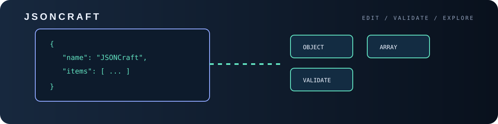

# JSONCraft

A visual, mobile-first JSON editor for people who want to work with structured data without writing every bracket by hand.

**Live app:** https://error404dtir.github.io/jsoncraft/

## Features

- Visual editor for strings, numbers, booleans, null, objects and arrays
- Change the value type of an existing field
- Structure explorer with nested navigation and field search
- Add, rename, duplicate and delete properties or array items
- Raw JSON editor with live parsing, validation and formatting
- Undo and redo for visual edits
- Import JSON files, copy the document and export a formatted .json file
- Local browser storage; no account and no server-side document storage
- Responsive layout designed for narrow phone screens as well as desktop

## Privacy and compatibility

Documents are stored in this browser's local storage. Import, editing and export happen client-side. Clearing site data removes the locally saved document, so export a copy when moving devices or clearing browser storage.

The interface uses Bootstrap Icons from jsDelivr and DM Sans / DM Mono from Google Fonts. The editor itself is plain HTML, CSS and JavaScript with no build step.

## Run locally

Open `index.html` in a modern browser, or serve the folder with any static file server.

## License

MIT